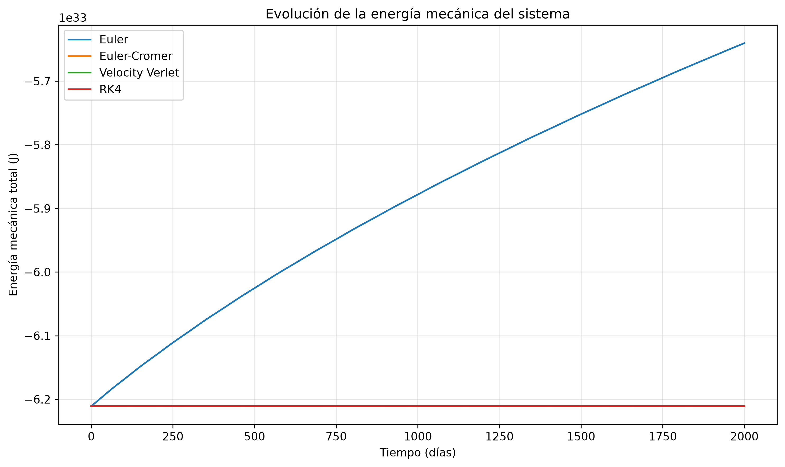
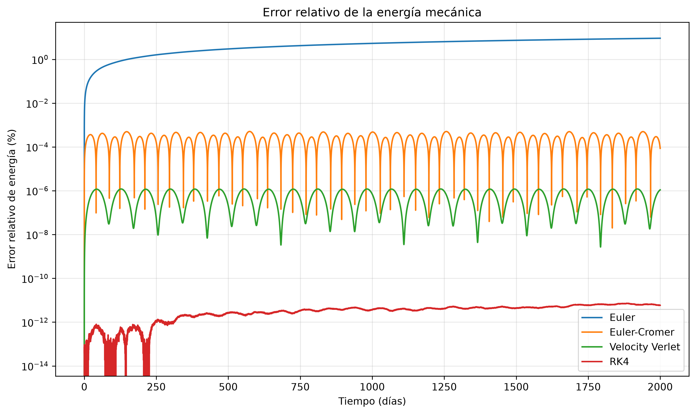
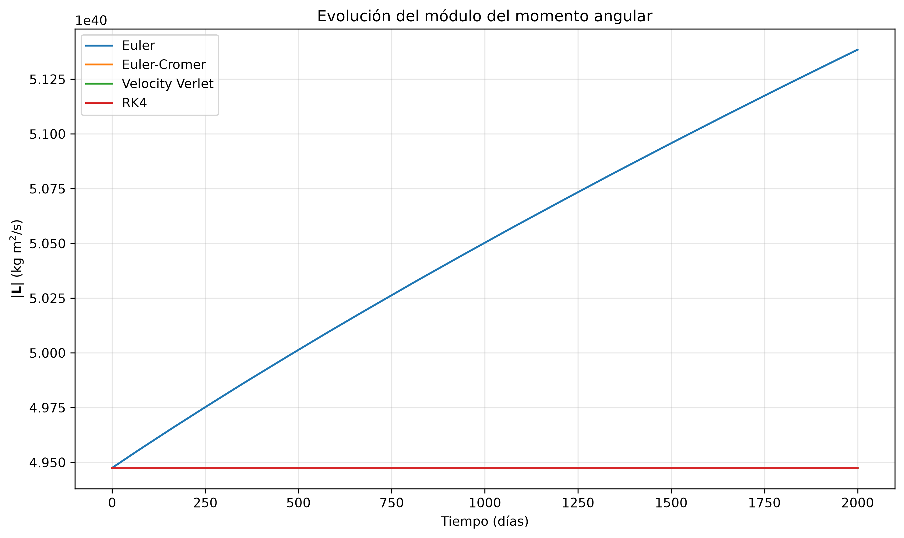
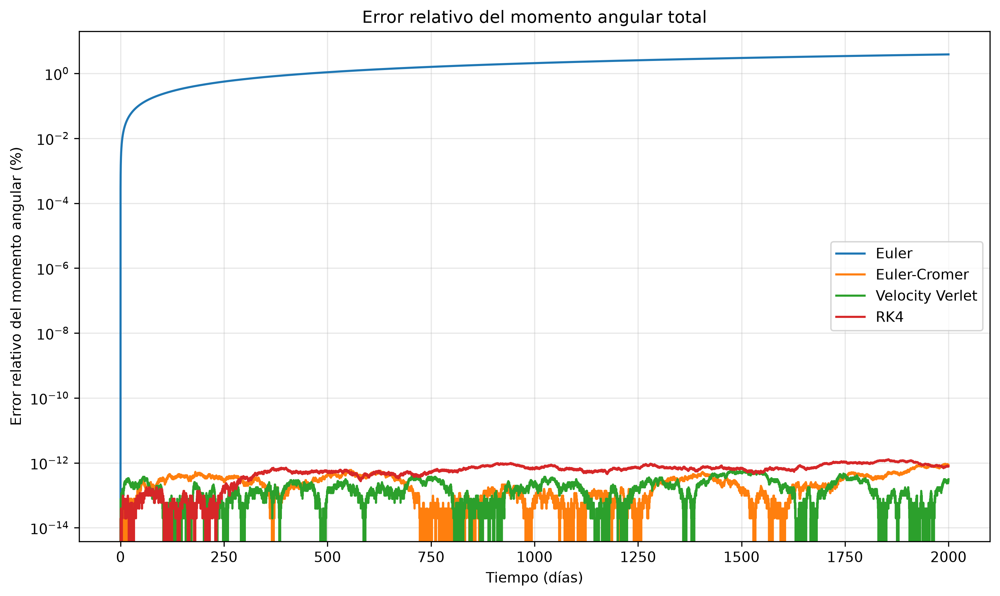

# Análisis de la simulación del Sistema Solar

Este proyecto analiza una simulación tridimensional del Sistema Solar interior desarrollada en Python. El proyecto nació como una exploración visual de la evolución de un sistema gravitatorio y se amplió con distintos métodos numéricos para estudiar cómo afecta el integrador a las órbitas y a la conservación de magnitudes físicas.

Se comparan los métodos de Euler explícito, Euler-Cromer, Velocity Verlet y Runge-Kutta de cuarto orden (RK4), a partir de los resultados obtenidos para un paso temporal de **3600 s, equivalente a una hora**, y un estudio cuyo horizonte de conservación es de **2000 días**.

_>&#x20;_**Conclusión principal.**_&#x20;RK4 ofrece la mayor precisión observada en este experimento a paso temporal fijo: conserva la energía mucho mejor que los demás métodos y produce soluciones muy próximas a Velocity Verlet. Sin embargo, los periodos de referencia no constituyen una solución exacta del mismo problema físico. Por eso, el menor error de Euler frente al periodo publicado de Mercurio no demuestra que Euler sea más preciso: es compatible con una compensación entre el sesgo de las condiciones iniciales o del modelo y la deriva numérica. Para una simulación prolongada con un buen equilibrio entre coste y comportamiento cualitativo, Velocity Verlet es una alternativa especialmente interesante._

## 1. Modelo físico

### 1.1. Objetivo y alcance

El objetivo es simular la evolución de varios cuerpos que interactúan mediante la gravedad newtoniana y comparar distintas aproximaciones numéricas de esa evolución. Los resultados de periodos aportados corresponden al Sol, Mercurio, Venus, la Tierra y Marte.

El estudio permite responder a dos tipos de preguntas diferentes:

1. **¿Qué método aproxima mejor la solución del modelo implementado?** Para ello interesan la convergencia al reducir el paso, la conservación de invariantes y la comparación con una solución numérica de referencia del mismo modelo.

2. **¿Hasta qué punto reproduce el modelo el Sistema Solar real?** Aquí también importan las condiciones iniciales, los cuerpos omitidos, las constantes físicas y las aproximaciones de la gravedad newtoniana.

La simulación visual permite observar órbitas, inclinaciones y estabilidad general. El análisis numérico complementa esa observación con medidas cuantitativas: primera vuelta orbital, energía mecánica total y momento angular total.

Una simulación de 2000 días como esta equivale aproximadamente a 5,48 años terrestres: es útil para comparar integradores, pero corta para estudiar su comportamiento en escalas astronómicas mucho mayores.

### 1.2. Hipótesis y aproximaciones

El modelo físico considerado se basa en las siguientes hipótesis:

- Los astros se representan como **cuerpos puntuales**, sin rotación, deformación ni distribución interna de masa.

- La interacción es la **gravedad newtoniana**, instantánea y de intensidad proporcional al inverso del cuadrado de la distancia.

- El sistema simulado está aislado: no se aplican fuerzas externas.

- Cada cuerpo atrae a los demás y puede moverse bajo su acción; no se supone necesariamente que el Sol esté fijo.

- No se modelan colisiones, fusiones ni contactos entre superficies.

- No se incluyen correcciones relativistas.

- Se desprecian la presión de radiación, el viento solar, las interacciones electromagnéticas, las mareas y otras fuerzas no gravitatorias.

- Solo se consideran los cuerpos incluidos en el modelo: el Sol y los cuatro planetas interiores.

La aproximación de cuerpos puntuales es razonable para estudiar el movimiento orbital de planetas suficientemente separados. Además, el campo exterior de una distribución esféricamente simétrica coincide con el de una masa puntual situada en su centro.

### 1.3. Sistema de referencia y unidades

La evolución física utiliza coordenadas cartesianas tridimensionales. El estado de cada cuerpo contiene su posición y su velocidad:

$$
\mathbf r_i=(x_i,y_i,z_i),\qquad \mathbf v_i=(v_{x,i},v_{y,i},v_{z,i}).
$$

Las unidades internas son:

| Magnitud | Unidad empleada |
|---|---|
| Posición | metro, m |
| Velocidad | m/s |
| Masa | kg |
| Tiempo de integración | segundo, s |
| Energía | julio, J |
| Momento angular | kg·m²/s |
| Presentación de periodos y gráficas | día de 86400 s |

En los cálculos se utilizan las constantes:

$$
G=6.67428\times10^{-11}\ \mathrm{m^3\,kg^{-1}\,s^{-2}},
$$

$$
1\ \mathrm{UA}=149.6\times10^9\ \mathrm{m}, \qquad 1\ \mathrm{día}=86400\ \mathrm{s}.
$$

Las posiciones se expresan en unidades astronómicas y se convierten a metros; las velocidades se expresan en m/s. El día empleado es una unidad de duración fija.

Estos valores de $G$ y de la UA son aproximaciones. JPL recoge $G=6.67430\times10^{-11}\ \mathrm{m^3\,kg^{-1}\,s^{-2}}$ y una UA de $149597870700$ m [1](https://ssd.jpl.nasa.gov/astro_par.html). La diferencia relativa de la UA empleada es aproximadamente un 0,001423 %, y la de $G$, un 0,000300 % respecto al valor recomendado citado. Son diferencias pequeñas frente a las discrepancias de periodo de varias décimas o varios porcentajes observadas aquí. Por sí solas, no constituyen una explicación convincente del error de casi el 3 % de Mercurio.

Para comparar con efemérides de alta precisión es preferible utilizar parámetros gravitatorios $GM$ coherentes con la fuente de datos, en lugar de combinar masas y constantes de procedencias distintas.

### 1.4. Ecuaciones del movimiento

La fuerza ejercida sobre el cuerpo $i$ por el cuerpo $j$ es:

$$
\mathbf F_{ij} =Gm_i m_j \frac{\mathbf r_j-\mathbf r_i} {\|\mathbf r_j-\mathbf r_i\|^3}.
$$

El método `Planeta.gravedad()` calcula esta expresión mediante las diferencias de coordenadas, el cuadrado de la distancia y su raíz. La fuerza total sobre $i$ se obtiene sumando las contribuciones de todos los demás cuerpos. Al dividir por $m_i$, su aceleración queda:

$$
\frac{d^2\mathbf r_i}{dt^2} =\mathbf a_i =G\sum_{j\ne i}m_j \frac{\mathbf r_j-\mathbf r_i} {\|\mathbf r_j-\mathbf r_i\|^3}.
$$

Para la componente $x$:

$$
\frac{dx_i}{dt}=v_{x,i},
$$

$$
\frac{dv_{x,i}}{dt} =G\sum_{j\ne i}m_j \frac{x_j-x_i} {\left[(x_j-x_i)^2+(y_j-y_i)^2+(z_j-z_i)^2\right]^{3/2}},
$$

con expresiones análogas para $y$ y $z$.

Así, las $N$ ecuaciones vectoriales de segundo orden se convierten en un sistema de $6N$ ecuaciones escalares de primer orden. Para cinco cuerpos hay 30 variables de estado. El sistema está acoplado: la aceleración de cada planeta depende de las posiciones de los demás, por lo que las órbitas no son problemas de dos cuerpos completamente independientes.

### 1.5. Magnitudes físicas conservadas

#### Energía mecánica total

La función `energia()` calcula:

$$
E=K+U,
$$

$$
K=\sum_i \frac{1}{2}m_i\left\lVert\mathbf{v}_i\right\rVert^2,
$$

$$
U=-\sum_{i < j}\frac{Gm_i m_j}{r_{ij}}, \qquad r_{ij}=\left\lVert\mathbf{r}_j-\mathbf{r}_i\right\rVert.
$$

Como el potencial no depende explícitamente del tiempo y no hay fuerzas externas ni disipativas, la solución exacta conserva $E$. Una variación de la energía calculada a partir de la trayectoria numérica es, por tanto, un indicador del error del integrador y del redondeo, no una pérdida física contemplada por el modelo.

#### Momento angular total

El momento angular total del sistema se expresa mediante el vector:

$$
\mathbf L=\sum_i m_i(\mathbf r_i\times\mathbf v_i).
$$

Las fuerzas internas cumplen la tercera ley de Newton y están dirigidas a lo largo de la línea que une cada pareja. En consecuencia, sus pares de fuerzas no producen un momento neto:

$$
\frac{d\mathbf L}{dt} =\sum_{i < j}(\mathbf r_i-\mathbf r_j)\times\mathbf F_{ij} =\mathbf 0.
$$

Se conservan el vector completo y, por tanto, su módulo.

### 1.6. Limitaciones del modelo

La principal limitación no es que la gravedad newtoniana resulte inadecuada para una primera simulación, sino que el problema resuelto no coincide exactamente con el Sistema Solar real:

- **Cuerpos omitidos.** El modelo incluye únicamente el Sol y los cuatro planetas interiores. Por tanto, no incorpora las perturbaciones de Júpiter y Saturno ni las de los restantes planetas y cuerpos menores, que sí están presentes en la dinámica real del Sistema Solar.

- **Tierra y Marte como cuerpos individuales.** La Luna no está incluida como cuerpo independiente, por lo que el modelo no reproduce las perturbaciones lunares sobre la trayectoria terrestre.

- **Ausencia de relatividad.** El avance relativista del perihelio de Mercurio incluye una contribución de unos 43 segundos de arco por siglo que la teoría newtoniana no explica [1](https://imagine.gsfc.nasa.gov/educators/programs/cosmictimes/educators/workshops/docs/InquiringIntoNatureUniverse/Newton_Einstein_FactCards.pdf). Es una limitación conceptual importante, pero no una justificación plausible para una discrepancia de 2,59 días en una primera vuelta.

- **Ausencia de estructura interna.** No se contemplan el achatamiento, los armónicos gravitatorios, las mareas ni el acoplamiento entre rotación y órbita.

- **Encuentros próximos.** No se contempla la posibilidad de que dos planetas colisionen, o cual no afecta a la simulación del sistema solar pero podría producir error en otros sistemas gravitatorios.

- **Horizonte temporal limitado.** Un buen comportamiento durante 2000 días no garantiza precisión de fase ni estabilidad durante miles o millones de órbitas.

Estas aproximaciones son aceptables para el objetivo didáctico y comparativo del proyecto.

---

## 2. Métodos de integración numérica

### 2.1. Introducción

Para un sistema de varios cuerpos no se dispone de una solución general cerrada comparable a la órbita kepleriana de dos cuerpos. Es necesario aproximar la trayectoria mediante pasos temporales.

Se define el estado global:

$$
\mathbf y=(\mathbf r_1,\ldots,\mathbf r_N, \mathbf v_1,\ldots,\mathbf v_N),
$$

cuya evolución viene dada por:

$$
\frac{d\mathbf y}{dt}=f(t,\mathbf y) =(\mathbf v_1,\ldots,\mathbf v_N, \mathbf a_1,\ldots,\mathbf a_N).
$$

La gravedad newtoniana autónoma no depende explícitamente de $t$, aunque se mantenga esa variable en la formulación general de los métodos.

El paso $h=\Delta t$ controla la resolución temporal. Reducirlo suele disminuir el error de discretización, pero aumenta el número de pasos y puede acabar haciendo dominante el redondeo. El orden del método describe cómo disminuye el error en un intervalo finito bajo hipótesis de suavidad; no garantiza por sí solo una buena conservación durante tiempos arbitrariamente largos.

### 2.2. Método de Euler explícito

Euler explícito aproxima la derivada por su valor al comienzo del intervalo:

$$
\mathbf r_{n+1}=\mathbf r_n+h\mathbf v_n,
$$

$$
\mathbf v_{n+1}=\mathbf v_n+h\mathbf a_n.
$$

Las dos actualizaciones utilizan el estado antiguo. Posee error local de truncamiento de orden $O(h^2)$ y **error global de orden $O(h)$**. Necesita una evaluación de aceleraciones por paso y tiene un coste directo de $O(N^2)$ para un sistema de $N$ cuerpos sin optimizaciones de suma de fuerzas.

Sus ventajas son la sencillez, la facilidad de implementación y su valor como método de referencia. Su principal problema es que no posee la estructura geométrica adecuada para conservar el comportamiento orbital a largo plazo. En problemas oscilatorios suele introducir una deriva de energía incluso con pasos relativamente pequeños.

Para este modelo, el momento angular tampoco se conserva exactamente. Al sustituir las actualizaciones de Euler y usar la anulación del par de fuerzas internas aparece:

$$
\mathbf L_{n+1}-\mathbf L_n =h^2\sum_i m_i\mathbf v_n^{\,i}\times\mathbf a_n^{\,i},
$$

que en general no es cero. Esta pérdida de conservación es coherente con la fuerte deriva observada en las gráficas.

### 2.3. Método de Euler-Cromer

Euler-Cromer, también llamado Euler semiimplícito o simpléctico en esta formulación, actualiza primero la velocidad y después la posición con la velocidad nueva:

$$
\mathbf v_{n+1}=\mathbf v_n+h\mathbf a(\mathbf r_n),
$$

$$
\mathbf r_{n+1}=\mathbf r_n+h\mathbf v_{n+1}.
$$

Aunque sigue siendo de **primer orden global**, su comportamiento en sistemas hamiltonianos separables es mucho mejor que el de Euler explícito. Es un método simpléctico: preserva la estructura geométrica del problema, no el valor exacto de la energía original. Bajo condiciones apropiadas, su energía suele presentar oscilaciones acotadas alrededor del valor correcto, en lugar de una deriva sistemática rápida.

Necesita una evaluación de aceleraciones por paso. Para fuerzas centrales evaluadas de forma consistente, conserva el momento angular salvo redondeo. No es, en general, reversible temporalmente.

Su bajo coste lo hace atractivo para una visualización interactiva y para simulaciones largas en las que interese evitar una deriva artificial de energía. Sus inconvenientes son el error de fase de primer orden y la menor precisión que Verlet con un paso comparable.

### 2.4. Método Velocity Verlet

Velocity Verlet actualiza la posición mediante la velocidad y aceleración iniciales:

$$
\mathbf r_{n+1} =\mathbf r_n+h\mathbf v_n+\frac12h^2\mathbf a_n.
$$

Después calcula la aceleración en la nueva posición y actualiza la velocidad:

$$
\mathbf a_{n+1}=\mathbf a(\mathbf r_{n+1}),
$$

$$
\mathbf v_{n+1} =\mathbf v_n+\frac h2(\mathbf a_n+\mathbf a_{n+1}).
$$

Tiene **segundo orden global**. Si se reutiliza la última aceleración como la inicial del siguiente paso, solo necesita una evaluación nueva de aceleraciones por paso. Una implementación que recalcule ambas puede hacer dos evaluaciones, aunque la segunda sea redundante.

Es simpléctico y reversible temporalmente para un problema gravitatorio newtoniano con paso fijo. Para fuerzas centrales conserva el momento angular salvo redondeo. Su energía no es exactamente constante, pero suele oscilar alrededor del valor inicial sin una deriva secular importante mientras se mantengan las condiciones que explican ese comportamiento.

Ofrece un buen equilibrio entre coste, sencillez y fidelidad cualitativa. Su precisión de fase es inferior a la de RK4 a igual paso en este experimento, y los encuentros próximos o un paso excesivo pueden deteriorar sus ventajas. Además, cambiar ingenuamente el paso de manera adaptativa puede romper las propiedades geométricas que lo hacen atractivo.

### 2.5. Método Runge-Kutta de cuarto orden (RK4)

RK4 combina cuatro evaluaciones del campo de derivadas dentro de cada paso. Para el estado completo $\mathbf y$:

$$
\mathbf k_1=f(t_n,\mathbf y_n),
$$

$$
\mathbf k_2=f\left(t_n+\frac h2, \mathbf y_n+\frac h2\mathbf k_1\right),
$$

$$
\mathbf k_3=f\left(t_n+\frac h2, \mathbf y_n+\frac h2\mathbf k_2\right),
$$

$$
\mathbf k_4=f(t_n+h,\mathbf y_n+h\mathbf k_3),
$$

$$
\mathbf y_{n+1} =\mathbf y_n+\frac h6 (\mathbf k_1+2\mathbf k_2+2\mathbf k_3+\mathbf k_4).
$$

Cada $\mathbf k$ contiene componentes de velocidad y de aceleración. Las aceleraciones de las etapas deben evaluarse con las posiciones intermedias correspondientes; no basta con aplicar los coeficientes de RK4 a las posiciones ignorando las velocidades de etapa.

Su error global es de **cuarto orden**, $O(h^4)$, y necesita cuatro evaluaciones del campo de aceleraciones por paso. Requiere más operaciones y almacenamiento temporal que los otros esquemas.

RK4 suele proporcionar una precisión puntual muy alta con pasos moderados. No es simpléctico y no garantiza conservación exacta de la energía ni de todos los invariantes cuadráticos. En integraciones muy largas puede aparecer una deriva acumulada, aunque sea mucho menor que la de Euler. Las pequeñas variaciones observadas con RK4 pueden combinar error de truncamiento y redondeo; las gráficas por sí solas no permiten separar ambas contribuciones.

### 2.6. Comparación teórica de los métodos

| Método | Orden global | Evaluaciones nuevas de aceleración por paso | Conservación y estructura | Comportamiento orbital esperado |
|---|---:|---:|---|---|
| Euler explícito | 1 | 1 | No simpléctico; no conserva exactamente $E$ ni $\mathbf L$ | Deriva de energía y deformación progresiva de la órbita |
| Euler-Cromer | 1 | 1 | Simpléctico; $\mathbf L$ conservado salvo redondeo | Energía normalmente oscilante; error de fase relativamente grande |
| Velocity Verlet | 2 | 1 reutilizando la aceleración final | Simpléctico y reversible; $\mathbf L$ conservado salvo redondeo | Buen comportamiento cualitativo a largo plazo con paso adecuado |
| RK4 | 4 | 4 | No simpléctico; conservación no garantizada exactamente | Gran precisión a corto y medio plazo; posible deriva muy lenta |

Las propiedades simplécticas no significan que la energía original se conserve de manera exacta. Se puede interpretar el método como una aproximación muy cercana a la evolución de un **hamiltoniano modificado**, cercano al original. Esto ayuda a entender por qué un método de orden inferior puede ser preferible a otro de orden superior en ciertos estudios largos.

El número de evaluaciones tampoco equivale directamente a tiempo de ejecución medido. Depende de la implementación, del número de cuerpos y del coste de representación visual.

---

## 3. Configuración experimental

### 3.1. Parámetros de las simulaciones

| Parámetro | Configuración utilizada |
|---|---|
| Modelo físico | Gravedad newtoniana entre cuerpos puntuales |
| Sistema de los resultados | Sol, Mercurio, Venus, Tierra y Marte |
| Métodos | Euler, Euler-Cromer, Velocity Verlet y RK4 |
| Paso físico de análisis | $h=3600$ s = 1 h = 1/24 de día |
| Duración de conservación | 2000 días = 172800000 s |
| Pasos de conservación por método | 48000 |
| Instantes registrados por método | 48001, incluidos $t=0$ y $t=2000$ días |
| Condiciones iniciales | Sol, Mercurio, Venus, Tierra y Marte |
| Aritmética de los estados | Números de Python/NumPy; habitualmente doble precisión |
| Referencias de periodo | 87,969; 224,701; 365,256; 686,980 días |

#### Diferencia entre el experimento de periodos y el de conservación

Los periodos corresponden a la primera vuelta orbital de cada planeta, mientras que el estudio de conservación de energía y momento angular se prolonga durante 2000 días. Por tanto, ambos análisis tienen horizontes temporales distintos.

La última detección de una primera vuelta se produce aproximadamente entre los 683 y 686 días, según el método. Las gráficas de conservación, en cambio, cubren los 2000 días completos.

Esta distinción evita atribuir a la duración del estudio de conservación un papel que no tiene en la medida de la primera vuelta.

#### Parámetros exclusivamente visuales

La visualización tridimensional utiliza una escala espacial y tamaños de representación elegidos para que los cuerpos y sus órbitas puedan distinguirse con claridad. Por tanto, los radios mostrados no están a la misma escala que las distancias y no deben utilizarse para juzgar tamaños relativos o posibles colisiones.

La velocidad de reproducción y la frecuencia con la que se actualizan las trazas y las órbitas afectan a la experiencia visual, pero no modifican las unidades físicas ni los resultados numéricos del experimento de análisis.

### 3.2. Procedimiento de comparación

Cada integrador comienza desde las mismas condiciones iniciales, de modo que la comparación no parte del estado final obtenido por otro método. Los periodos y las magnitudes conservadas se calculan también tomando como referencia ese mismo estado inicial.

En los cuatro casos se utiliza el mismo paso de análisis, el mismo horizonte de conservación y las mismas fórmulas de energía y momento angular. Los métodos se ejecutan de forma secuencial y los resultados se guardan por separado.

Esta comparación controla correctamente las condiciones de partida, pero tiene dos límites:

1. **Igual paso no significa igual coste.** RK4 realiza cuatro evaluaciones de aceleraciones por paso, frente a una de los otros métodos en implementaciones eficientes.

2. **Igual referencia astronómica no significa igual error de integración.** Todos comparten el mismo modelo físico y los mismos datos iniciales, pero la referencia publicada no es la solución exacta de ese modelo.

Para una comparación rigurosa de precisión deben añadirse una solución de referencia del mismo problema y un estudio de convergencia. Para comparar eficiencia deben medirse errores a igual presupuesto de evaluaciones o de tiempo de cómputo.

---

## 4. Análisis de los periodos orbitales

### 4.1. Procedimiento de cálculo

Para cada planeta se define su posición relativa al Sol:

$$
\boldsymbol\rho_i=\mathbf r_i-\mathbf r_\odot.
$$

Para estimar el periodo, calculo el ángulo azimutal de la proyección de la posición relativa sobre el plano XY:

$$
\phi_i=\mathrm{atan2}(\rho_{y,i},\rho_{x,i}).
$$

`atan2` selecciona el cuadrante correcto y devuelve un ángulo envuelto en el intervalo $(-\pi,\pi]$. Para evitar el salto artificial al cruzar la rama de corte, el incremento entre dos instantes se corrige mediante:

$$
\delta_n=\mathrm{atan2} \left(\sin(\phi_{n+1}-\phi_n), \cos(\phi_{n+1}-\phi_n)\right).
$$

Después se acumulan los incrementos hasta alcanzar una magnitud de $2\pi$. El signo permite tratar órbitas retrógradas, siempre que el movimiento angular sea suficientemente regular.

Si $\Theta_n$ es el ángulo acumulado antes del paso y $\Theta_{n+1}=\Theta_n+\delta_n$ supera el objetivo $\Theta=\pm2\pi$, el instante de cruce se estima mediante interpolación lineal:

$$
\lambda=\frac{\Theta_*-\Theta_n}{\delta_n}, \qquad T_{\mathrm{num}}=t_n+\lambda h.
$$

La interpolación permite obtener una estimación del instante de cruce entre dos muestras, en lugar de redondear el periodo a un múltiplo entero de una hora.

#### Limitaciones del estimador

**a) Mide una vuelta azimutal, no el retorno completo del estado.** El planeta no tiene por qué recuperar exactamente la misma distancia al Sol, velocidad, altura sobre XY o elementos orbitales cuando su azimut acumulado cambia en $2\pi$. En un problema de dos cuerpos ideal, cerrado y con un plano orbital fijo, esa vuelta coincide con el periodo kepleriano, incluso bajo una proyección no degenerada. En un sistema perturbado, la precesión y la variación del plano hacen que la equivalencia deje de ser exacta.

**b) Ignora explícitamente la componente $z$.** Para órbitas poco inclinadas puede ser una buena aproximación, pero no es un detector general de revolución en el plano orbital instantáneo.

**c) Supone incrementos angulares menores que media vuelta.** El desenvuelto identifica el incremento principal. Con una órbita estable y $h=1$ h, Mercurio avanza como media unos 0,1705 grados por paso, muy por debajo de 180 grados. La hipótesis es razonable en ese régimen, pero una solución inestable podría invalidarla.

**d) La interpolación no elimina el error de la trayectoria.** Para un ángulo suave con velocidad angular no nula, el error local de interpolación temporal suele ser de orden $O(h^2)$, pero el error de fase acumulado por el integrador permanece. No puede garantizarse que el error del periodo sea menor que media hora solo porque las muestras estén separadas una hora.

**e) Se mide una sola vuelta.** El resultado depende de la fase inicial, del punto donde se detecta el cierre y de las perturbaciones durante ese intervalo. Una media de varias revoluciones reduciría la sensibilidad a la fase, aunque no corregiría un sesgo físico o numérico sistemático.

**f) La salida tiene más dígitos que precisión demostrada.** Seis decimales en días equivalen a 0,0864 s. Ese es el formato de impresión, no una incertidumbre de 0,0864 s ni una validación de todas las cifras.

### 4.2. Valores de referencia

El diccionario `PERIODOS_REFERENCIA` contiene:

| Planeta | Periodo de referencia, días | Tipo de valor compatible |
|---|---:|---|
| Mercurio | 87,969 | Periodo sideral publicado por NASA NSSDC [4](https://nssdc.gsfc.nasa.gov/planetary/factsheet/mercuryfact.html) |
| Venus | 224,701 | Periodo sideral publicado por NASA NSSDC [1](https://nssdc.gsfc.nasa.gov/planetary/factsheet/venusfact.html) |
| Tierra | 365,256 | Periodo sideral publicado por NASA NSSDC [1](https://nssdc.gsfc.nasa.gov/planetary/factsheet/earthfact.html) |
| Marte | 686,980 | Periodo sideral publicado por NASA NSSDC [2](https://nssdc.gsfc.nasa.gov/planetary/factsheet/marsfact.html) |

### 4.3. Error relativo

Calculo:

$$
\varepsilon_T= \frac{|T_{\mathrm{num}}-T_{\mathrm{ref}}|} {T_{\mathrm{ref}}}\times100.
$$

Es una **discrepancia relativa frente a una referencia astronómica**, no una medida pura del error de discretización. De manera esquemática contiene:

$$
\text{diferencia observada} =\text{efecto del integrador} +\text{efecto de las condiciones iniciales} +\text{diferencia de modelo} +\text{diferencia de definición del periodo}.
$$

La descomposición es conceptual, no una suma de términos que se hayan medido por separado. El valor absoluto oculta el signo: un periodo demasiado corto y otro demasiado largo pueden mostrar el mismo porcentaje.

### 4.4. Resultados

Los periodos proporcionados, en días de 86400 s, son:

| Planeta | Euler | Euler-Cromer | Velocity Verlet | RK4 | Referencia |
|---|---:|---:|---:|---:|---:|
| Mercurio | 87,870332 | 85,376929 | 85,376649 | 85,376384 | 87,969000 |
| Venus | 226,850138 | 224,374057 | 224,373945 | 224,373843 | 224,701000 |
| Tierra | 367,663918 | 365,190867 | 365,190772 | 365,190709 | 365,256000 |
| Marte | 685,415028 | 682,944778 | 682,944754 | 682,944721 | 686,980000 |

Los errores relativos obtenidos son:

| Planeta | Euler, % | Euler-Cromer, % | Velocity Verlet, % | RK4, % |
|---|---:|---:|---:|---:|
| Mercurio | 0,112162 | 2,946574 | 2,946892 | 2,947193 |
| Venus | 0,956443 | 0,145501 | 0,145551 | 0,145597 |
| Tierra | 0,659241 | 0,017832 | 0,017858 | 0,017875 |
| Marte | 0,227805 | 0,587386 | 0,587389 | 0,587394 |

Se conservan los errores de la salida original. Al recalcularlos usando únicamente los periodos ya redondeados puede cambiar la última cifra decimal, sin relevancia física.

### 4.5. Interpretación

#### Euler-Cromer, Verlet y RK4 describen prácticamente la misma primera vuelta

Los tres métodos producen periodos muy próximos entre sí. Frente a RK4, sus diferencias son:

| Planeta | Euler-Cromer − RK4, s | Verlet − RK4, s |
|---|---:|---:|
| Mercurio | 47,0880 | 22,8960 |
| Venus | 18,4896 | 8,8128 |
| Tierra | 13,6512 | 5,4432 |
| Marte | 4,9248 | 2,8512 |

Todas son menores que el paso de 3600 s, algo posible gracias a la interpolación del cruce. No obstante, estar por debajo del paso no convierte automáticamente esas diferencias en cotas de error. La cercanía entre Verlet y RK4 es un argumento a favor de que describen una órbita muy similar; confirmarlo exige comparar posiciones, velocidades y convergencia, no solo cuatro periodos.

#### El buen periodo de Mercurio con Euler es engañoso

Para RK4, la diferencia con signo respecto a la referencia es:

$$
85.376384-87.969000=-2.592616\ \text{días}.
$$

Euler obtiene en cambio:

$$
87.870332-87.969000=-0.098668\ \text{días}.
$$

Es decir, Euler alarga la primera vuelta unas 2,494 días respecto a RK4 y termina mucho más cerca del valor publicado. Al mismo tiempo, las gráficas muestran que Euler es el método que peor conserva la energía y el momento angular.

La explicación más razonable es una **compensación de errores**: la trayectoria de partida o el modelo producen una vuelta más corta que la referencia, mientras que la deriva de Euler modifica la órbita en sentido contrario. El aumento de energía hace al sistema menos ligado y es compatible con órbitas más amplias y lentas, aunque el cambio simultáneo de excentricidad y momento angular impide atribuir todo el efecto a una única variable.

Esta interpretación es coherente con los datos, aunque no permite identificar por sí sola el origen concreto del desajuste. Lo que sí demuestra el conjunto de resultados es que **un error pequeño frente a un periodo externo no basta para declarar ganador a un integrador**.

#### El signo del desajuste no es el mismo en todos los planetas

Con RK4, Mercurio, Venus, la Tierra y Marte completan la vuelta antes que sus referencias. Con Euler, Venus y la Tierra lo hacen después, mientras Mercurio y Marte siguen haciéndolo antes. Esto muestra que no hay un único factor multiplicativo que corrija todos los periodos a la vez.

Marte tiene la mayor discrepancia absoluta con RK4, unos 4,035 días, pero Mercurio tiene el mayor error relativo porque su periodo es mucho menor. Conviene distinguir ambas formas de medir el desacuerdo.

---

## 5. Análisis de la energía mecánica

### 5.1. Definición

Se utiliza la energía total del sistema:

$$
E(t)=\sum_i \frac{1}{2}m_i\left\lVert\mathbf{v}_i(t)\right\rVert^2 - \sum_{i<j}\frac{Gm_i m_j}{r_{ij}(t)}.
$$

El valor negativo es compatible con un sistema ligado, tomando el cero de potencial en separación infinita. Que la energía aumente hacia valores menos negativos no significa que se acerque a cero por un proceso físico del modelo: puede ser una ganancia artificial introducida por la discretización.

### 5.2. Indicador de conservación

Calculo:

$$
\varepsilon_E(t)= \frac{|E(t)-E(0)|}{|E(0)|}\times100.
$$

El valor absoluto del denominador permite interpretar correctamente el porcentaje aunque $E(0)<0$. El indicador mide la desviación respecto al estado inicial, no respecto a una solución analítica desconocida.

Un error pequeño es una señal favorable, pero no garantiza que la fase orbital sea correcta. Dos trayectorias pueden conservar casi la misma energía y encontrarse en lugares distintos de sus órbitas.

### 5.3. Resultados

**Evolución de la energía mecánica**

**Error relativo de la energía**

### 5.4. Interpretación

#### Euler: deriva acumulada

La curva azul muestra una ganancia sostenida de energía. Durante los primeros cientos de días la variación es especialmente rápida y después se modera, pero no desaparece. El resultado es una modificación acumulativa de la trayectoria, no una simple oscilación alrededor de la órbita correcta.

Esta conducta concuerda con el carácter no simpléctico de Euler y con su bajo orden. También explica por qué sus periodos se separan de los obtenidos con los otros integradores. La simulación no permite afirmar que un planeta vaya a escapar inmediatamente, pero tampoco ofrece garantías de estabilidad si se prolongara el cálculo.

#### Euler-Cromer y Verlet: oscilaciones sin deriva importante

Las curvas naranja y verde de la gráfica logarítmica presentan oscilaciones repetidas. Son compatibles con el comportamiento esperado de integradores simplécticos: conservan una estructura cercana a la del sistema original y mantienen acotada la variación de energía en este intervalo.

Los descensos pronunciados representan pasos por errores muy pequeños o por cancellingaciones cercanas al valor inicial; no significan que el método se vuelva exacto de forma permanente. En una escala logarítmica, un error nulo no puede representarse y las cercanas cancelaciones pueden producir valles muy profundos.

Verlet reduce los máximos de energía entre dos y tres órdenes de magnitud respecto a Euler-Cromer en estas gráficas. Esa mejora es coherente con su mayor orden, aunque la relación exacta depende de las escalas temporales dominantes y no debe extrapolarse sin un estudio de convergencia.

#### RK4: máxima precisión observada, no conservación exacta

RK4 mantiene el error de energía aproximadamente ocho órdenes de magnitud por debajo de los máximos de Euler-Cromer y unos seis por debajo de los de Verlet, según la escala porcentual de la figura. Es el mejor resultado observado a igual paso durante 2000 días.

Su curva no es perfectamente constante: aparece una variación lenta y pequeñas oscilaciones. Parte de la señal puede proceder del redondeo y parte del error de truncamiento. Para separar ambas causas habría que repetir el cálculo con otros pasos y, si se quiere estudiar el suelo de redondeo, con mayor precisión aritmética.

#### La gráfica lineal oculta las diferencias pequeñas

En la primera figura, Euler-Cromer, Verlet y RK4 parecen coincidir porque la escala vertical está dominada por la deriva de Euler. Esa superposición no demuestra igualdad. La gráfica logarítmica es la que permite distinguir su conservación.

Conviene complementarlas con una figura sin Euler o con un panel ampliado, y exportar los errores máximos, finales y una medida de deriva a largo plazo.

---

## 6. Análisis del momento angular

### 6.1. Definición

El momento angular total es:

$$
\mathbf L(t)=\sum_i m_i\bigl(\mathbf r_i(t)\times\mathbf v_i(t)\bigr).
$$

La función `momento_angular()` calcula sus tres componentes y conserva la información vectorial hasta el momento de evaluar los diagnósticos. La conservación se debe a la anulación de los momentos de las fuerzas internas, no a que cada órbita esté aislada.

### 6.2. Indicador de conservación

El error utilizado es:

$$
\varepsilon_L(t)= \frac{\|\mathbf L(t)-\mathbf L(0)\|} {\|\mathbf L(0)\|}\times100.
$$

Este indicador detecta cambios de módulo y de dirección. Es más completo que comparar únicamente $|\mathbf L(t)|$, pues dos vectores de igual longitud pero direcciones distintas no representan el mismo estado de rotación total.

La segunda gráfica muestra precisamente ese error vectorial, aunque su título hable de momento angular «total». La figura del módulo es un diagnóstico complementario, no la fuente del error vectorial.

### 6.3. Resultados

**Evolución del módulo del momento angular**

**Error relativo del momento angular**

De manera aproximada:

- Euler aumenta el módulo desde unos $4.947\times10^{40}$ hasta unos $5.138\times10^{40}$ kg·m²/s, un incremento cercano al 4 %.

- Euler-Cromer y Verlet permanecen cerca del suelo numérico, con errores aproximadamente entre $10^{-14}$ % y $10^{-12}$ %.

- RK4 presenta también un error muy pequeño, próximo a $10^{-12}$ % hacia el final, con una tendencia lenta visible en la escala logarítmica.

### 6.4. Interpretación

La deriva de Euler confirma que su actualización no respeta la conservación del momento angular. El cambio del vector completo y el crecimiento de su módulo indican que el error no se limita a las posiciones representadas en la gráfica de energía.

En Euler-Cromer, la actualización de la posición con la velocidad nueva hace que el término adicional del momento angular desaparezca para fuerzas centrales. Velocity Verlet posee una conservación análoga. Por eso sus curvas son compatibles con fluctuaciones de redondeo, en lugar de una deriva física apreciable. Las sumas de muchas contribuciones y las cancelaciones impiden exigir conservación bit a bit.

RK4 no ofrece la misma garantía algebraica general. Su comportamiento excelente durante este intervalo no debe convertirse en la afirmación de que conserva exactamente $\mathbf L$. La pequeña tendencia roja podría contener una contribución sistemática del método, pero se necesitarían pruebas adicionales para distinguirla del error acumulado de evaluación y suma.

La conservación del momento angular es una condición necesaria de una buena solución, pero no suficiente: Euler-Cromer y Verlet la conservan de forma muy similar y, sin embargo, muestran diferencias claras en energía y en periodo. Ninguna de estas medidas sustituye a la comparación directa de trayectorias.

---

## 7. Discusión general

### Precisión numérica frente a parecido con la realidad

El resultado más importante del estudio es que las dos preguntas iniciales no tienen la misma respuesta si se utiliza únicamente la tabla de periodos.

- Frente a los periodos publicados, Euler parece excelente para Mercurio.

- Frente a los demás integradores y a los invariantes, Euler es claramente el peor.

- Euler-Cromer, Verlet y RK4 coinciden mucho mejor entre sí, aunque compartan una discrepancia cercana al 3 % en Mercurio respecto a la referencia externa.

Esto muestra que la tabla de periodos está midiendo a la vez el integrador y la distancia entre el modelo simulado y el sistema astronómico de referencia. La conservación y la convergencia son herramientas más apropiadas para aislar la calidad numérica.

### Comparación por criterios

| Criterio | Mejor comportamiento observado o esperado |
|---|---|
| Conservación de energía durante 2000 días con $h=1$ h | RK4 |
| Conservación del momento angular | Euler-Cromer y Verlet, compatibles con conservación hasta redondeo; RK4 también muy preciso |
| Cercanía de los periodos entre métodos de mayor precisión | Verlet y RK4 |
| Estructura geométrica para integraciones largas | Euler-Cromer y especialmente Verlet |
| Menor número de evaluaciones por paso | Euler, Euler-Cromer y Verlet eficiente |
| Mayor orden formal | RK4 |
| Equilibrio entre coste y comportamiento orbital prolongado | Velocity Verlet, pendiente de comprobar a mayor duración |
| Método menos recomendable para este problema | Euler explícito |

No se puede deducir de la tabla cuál es más rápido en tiempo real: no se han medido tiempos ni errores a igual coste. RK4 necesita aproximadamente cuatro veces más evaluaciones de fuerza por paso que una implementación de Verlet que reutilice aceleraciones. Esa relación de trabajo no se traduce automáticamente en una relación de tiempo total, especialmente en la aplicación visual.

### Influencia del paso temporal

Con pasos suficientemente pequeños y en un intervalo finito, se espera que al reducir $h$ a la mitad el error global disminuya aproximadamente por:

- 2 en Euler y Euler-Cromer;

- 4 en Velocity Verlet;

- 16 en RK4.

Son relaciones asintóticas que deben comprobarse, no resultados ya medidos. Además, el error del detector de periodos y el redondeo pueden ocultar la pendiente esperada. En RK4, la energía es tan pequeña que un estudio realizado solo mediante ese invariante puede alcanzar pronto el suelo numérico.

Una elección óptima depende del objetivo. Para la precisión observada en este experimento, RK4 es preferible. Para una herramienta visual o una exploración larga con pocas evaluaciones, Verlet es una opción más equilibrada. Euler-Cromer sigue siendo útil como método económico y didáctico; Euler explícito sirve sobre todo para mostrar por qué el orden y la estructura del integrador importan.

### 7.1. Conclusiones

1. **RK4 es el método más preciso del conjunto en las condiciones ensayadas.** A una hora de paso y durante 2000 días ofrece el menor error de energía y periodos muy próximos a los de Velocity Verlet.

2. **Velocity Verlet proporciona el mejor compromiso cualitativo para prolongar la simulación con paso fijo.** Es de segundo orden, simpléctico, reversible y reutiliza aceleraciones. Su superioridad práctica a muy largo plazo frente a RK4 es una expectativa razonable, no algo demostrado todavía por estas cuatro gráficas.

3. **Euler-Cromer mejora radicalmente a Euler pese a tener el mismo orden formal.** La diferencia demuestra que las propiedades geométricas pueden importar tanto como el orden en un problema orbital.

4. **Euler explícito no es adecuado como integrador principal.** Su deriva de energía y momento angular modifica las órbitas de forma acumulativa.

5. **El error de Mercurio con Euler no debe interpretarse como una victoria.** Su aparente cercanía al periodo publicado es compatible con la compensación de errores y contradice la pérdida de conservación observada.

6. **El modelo es apropiado para explorar y comparar, no para producir efemérides verificadas.** La principal mejora pendiente no es añadir más cifras a la salida, sino documentar los datos y validar la convergencia respecto al mismo problema físico.

---

## 8. Objetivos y posibles mejoras

### 8.1. Objetivo de esta parte del proyecto

El objetivo de esta parte del proyecto es visualizar de manera sencilla las órbitas del Sistema Solar interior y comparar distintos métodos de integración numérica aplicados a un mismo modelo gravitatorio. La intención no es obtener efemérides de precisión ni construir todavía una representación física completa del Sistema Solar, sino disponer de una primera herramienta que permita observar el movimiento orbital y entender cómo influye el método numérico elegido en los resultados.

La comparación entre Euler explícito, Euler-Cromer, Velocity Verlet y Runge-Kutta de cuarto orden permite comprobar que no todos los métodos reproducen la evolución del sistema con la misma estabilidad ni conservan las magnitudes físicas con la misma precisión. Esta primera experiencia sirve como base para elegir y evaluar métodos que puedan utilizarse en simulaciones futuras, en las que sí será necesario prestar más atención a la precisión numérica.

### 8.2. Posibles mejoras de la simulación actual

Hay varias mejoras que podrían aplicarse a la parte del Sistema Solar del proyecto. Sin embargo, no se considera prioritario desarrollarlas ahora, ya que el tiempo disponible se destina a ampliar las funcionalidades que resultan más interesantes y que pueden aportar más al objetivo general del proyecto.

Entre las mejoras posibles de esta parte se encuentran:

- Incorporar más cuerpos del Sistema Solar y utilizar datos astronómicos iniciales más completos y precisos.

- Mejorar la representación de los cuerpos, pasando del modelo de masas puntuales a modelos que tengan en cuenta distribuciones de masa cuando resulte relevante.

- Introducir efectos relativistas para estudiar situaciones en las que la aproximación newtoniana no sea suficiente.

- Ampliar el análisis de las magnitudes conservadas, incluyendo el momento lineal total.

- Automatizar la exportación de la tabla de periodos orbitales a un archivo, en lugar de limitar su presentación a la salida del terminal.

Estas mejoras quedan como posibilidades para el futuro, pero no forman parte de las prioridades actuales. En particular, se prioriza centrar el desarrollo en mejorar el modelo físico mediante distribuciones de masa y relatividad, estudiar el momento lineal y utilizar mejores datos astronómicos, además de incorporar otras funcionalidades que amplíen el alcance del proyecto.

### 8.3. Mejoras orientadas a simulaciones futuras

La comparación realizada muestra que la elección del integrador debe depender del tipo de simulación que se quiera realizar. Para una visualización sencilla, los métodos estudiados permiten observar diferencias importantes sin necesidad de implementar desde el principio técnicas numéricas más complejas. En cambio, las simulaciones futuras que incorporen un modelo físico más elaborado necesitarán un estudio más exigente de la precisión, la estabilidad y el coste computacional.

Por ello, los resultados de esta primera parte se utilizarán como referencia para decidir qué métodos conviene estudiar con mayor profundidad. En esas futuras simulaciones será especialmente importante comprobar la convergencia al reducir el paso temporal y contrastar los resultados con soluciones de referencia adecuadas al modelo físico utilizado.

### 8.4. Mejorar la medida de periodos

Se recomienda:

1. Detectar varias revoluciones y estimar una media, conservando también la variación entre vueltas.

2. Comparar el detector azimutal con uno definido en el plano orbital inicial o instantáneo.

3. Registrar distancia, velocidad y elementos osculadores en el cierre para comprobar qué significa realmente «completar una vuelta».

4. Refinar el instante de cruce mediante un método de búsqueda de raíces y estados interpolados de mayor calidad.

5. Comparar periodos medios con definiciones astronómicas compatibles, distinguiendo sideral, anomalístico y otras alternativas.

6. No interpretar los decimales impresos como incertidumbre estadística.

Para los cuerpos poco inclinados del sistema interior, el detector actual puede ser suficiente como primera aproximación. Su principal limitación en este estudio no es necesariamente la proyección XY, sino la comparación de una sola vuelta de un modelo reducido con una referencia genérica.

### 8.5. Ampliar los diagnósticos y la duración

Sería conveniente añadir el momento lineal, la trayectoria del centro de masas, las distancias al Sol, los semiejes y excentricidades osculadores, y gráficas de diferencias de posición entre métodos. También ayudaría representar la energía sin Euler para distinguir mejor las curvas pequeñas.

Las simulaciones deberían repetirse durante decenas, cientos y miles de años, controlando el paso y comprobando que el buen comportamiento no sea exclusivo de las primeras órbitas. En estudios muy largos hay que distinguir deriva del integrador, crecimiento de errores por la dinámica y simple acumulación de redondeo.

### 8.6. Ampliación progresiva del modelo físico

Una de las líneas de desarrollo más interesantes es mejorar progresivamente el modelo físico de las simulaciones. Esto podría incluir la incorporación de distribuciones de masa en lugar de representar siempre los cuerpos como masas puntuales, así como la introducción de efectos relativistas cuando el problema estudiado lo requiera.

También será importante utilizar datos astronómicos iniciales más precisos y completos. La calidad de las condiciones iniciales y la coherencia de las magnitudes físicas empleadas condicionan la utilidad de cualquier comparación con el comportamiento real del Sistema Solar.

Estas ampliaciones se abordarán más adelante, cuando el objetivo de la simulación requiera ese nivel de detalle. La versión actual tiene un propósito más limitado: visualizar las órbitas del Sistema Solar interior y comparar métodos numéricos como preparación para desarrollos posteriores.

---

## Fuentes

Las fuentes externas utilizadas para contrastar los parámetros físicos y los valores astronómicos mencionados en este informe son:

- NASA NSSDC, fichas de Mercurio, Venus, Tierra y Marte, utilizadas como referencia para los periodos siderales nominales:

  - [Mercurio](https://nssdc.gsfc.nasa.gov/planetary/factsheet/mercuryfact.html).

  - [Venus](https://nssdc.gsfc.nasa.gov/planetary/factsheet/venusfact.html).

  - [Tierra](https://nssdc.gsfc.nasa.gov/planetary/factsheet/earthfact.html).

  - [Marte](https://nssdc.gsfc.nasa.gov/planetary/factsheet/marsfact.html).

- JPL Solar System Dynamics, constantes astrodinámicas y parámetros gravitatorios: [Astrodynamic Parameters](https://ssd.jpl.nasa.gov/astro_par.html).

- JPL Horizons, documentación sobre estados, elementos orbitales, marcos de referencia y escalas temporales: [Horizons System](https://ssd.jpl.nasa.gov/horizons/manual.html).

- NASA, material educativo sobre la precesión relativista de Mercurio: [Newton and Einstein](https://imagine.gsfc.nasa.gov/educators/programs/cosmictimes/educators/workshops/docs/InquiringIntoNatureUniverse/Newton_Einstein_FactCards.pdf).

Los resultados numéricos, las tablas y las gráficas comentados en el informe corresponden a los experimentos realizados para este proyecto. No se incluye aquí una correspondencia con archivos concretos del código.

